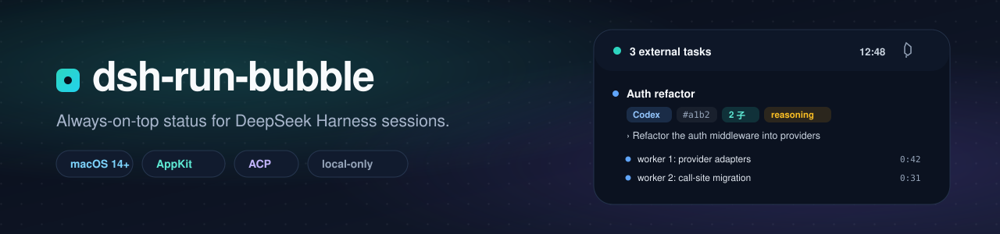
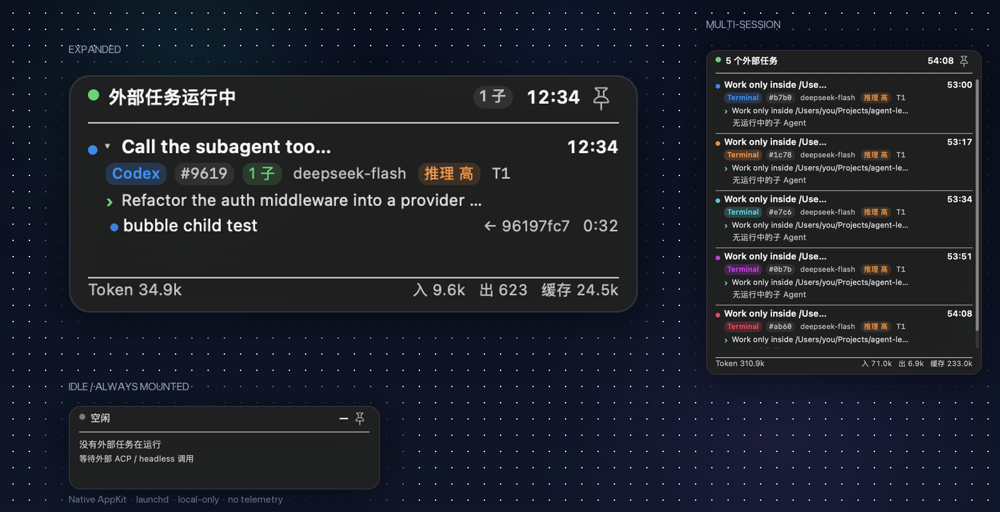
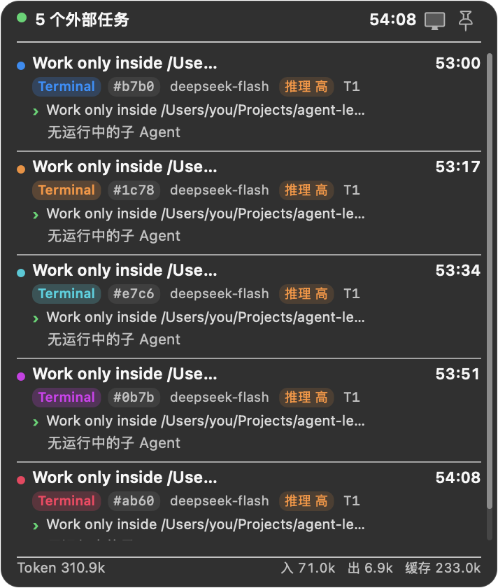
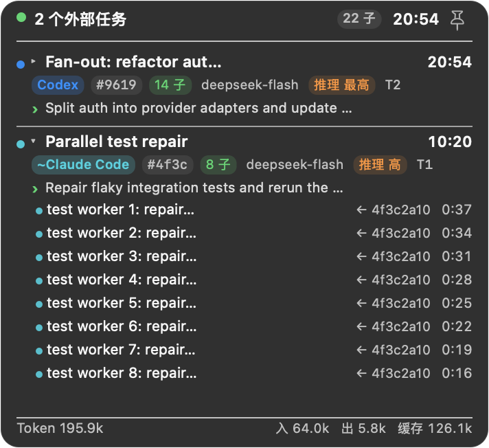
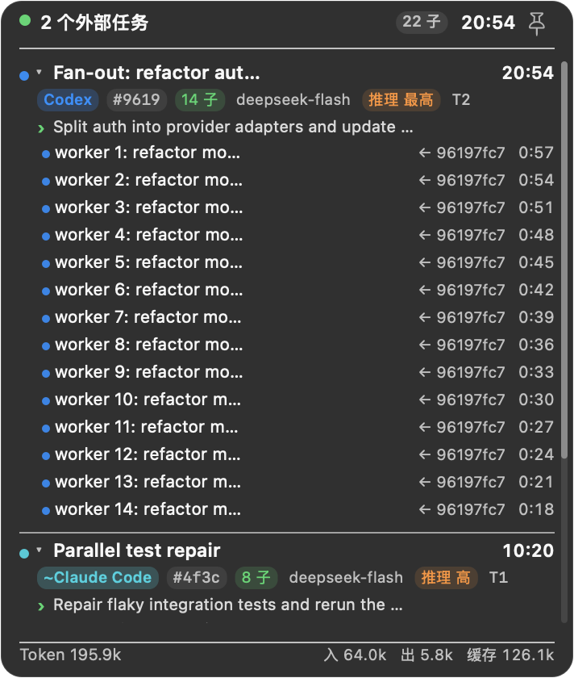
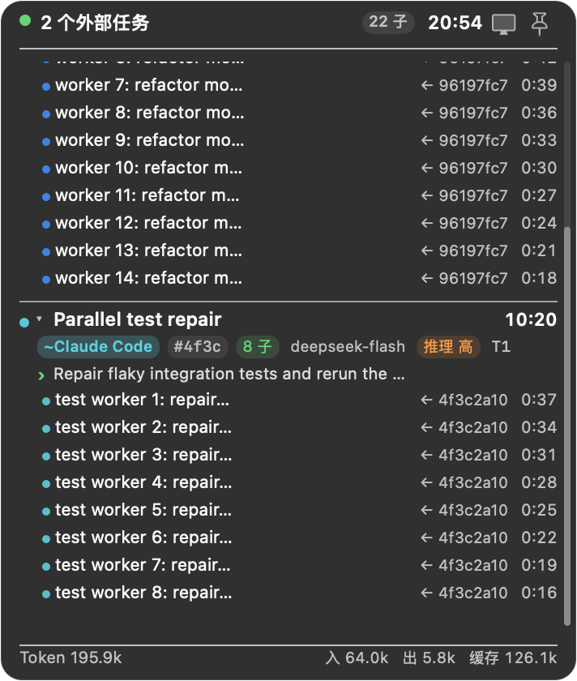
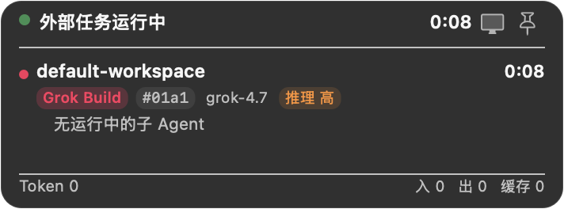
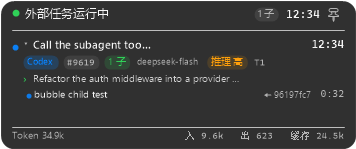
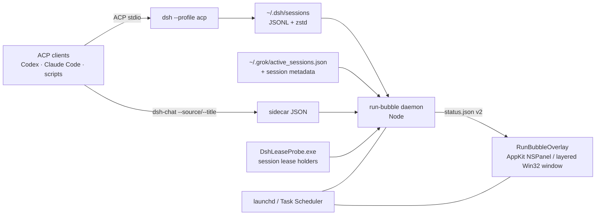

<p align="center">
  
</p>

<h1 align="center">dsh-run-bubble</h1>

<p align="center">
  <b>Always-on-top visibility for DeepSeek Harness and Grok Build sessions on macOS and Windows.</b><br>
  A native AppKit bubble on macOS, a layered Win32 window on Windows, both backed<br>
  by the same small Node daemon. See DSH roots, child agents, Grok Build TUIs,<br>
  tokens, models, and reasoning effort without switching windows.
</p>

<p align="center">
  <a href="https://github.com/Player-YN/dsh-run-bubble/actions/workflows/ci.yml"></a>
  
  
  
  
  
  
  
  
</p>

<p align="center">
  <a href="#quick-start">Quick start</a> ·
  <a href="#how-it-works">How it works</a> ·
  <a href="#metadata-contract">Metadata</a> ·
  <a href="#development">Development</a> ·
  <a href="README.zh-CN.md">简体中文</a>
</p>

<p align="center">
  
</p>

---

> **Built for external agent runs.** This is a status surface for sessions that
> *another* agent drives — Codex, Claude Code, Cursor, a script or a CI job calling
> `dsh --profile acp|headless|sdk`. The desktop app's own chats are filtered out by
> default so you never get two bubbles for the same conversation; flip the monitor
> button in the panel (or set `"includeDesktop": true` in `config.json`) if you want
> them in the bubble too.

## Why

Coding agents increasingly run in the background: Codex, Claude Code, Cursor, or a
scripted ACP client starts a DeepSeek Harness session, that session fans out into
subagents, and the only place to watch it is another terminal tab.

`dsh-run-bubble` is a **local, always-mounted status bubble** for those external
sessions. It is intentionally small: one Node daemon, one native panel, no
Electron, no WebView, no network calls, and no changes to the DSH kernel.

It is useful when you:

- run several ACP sessions in parallel and need to tell them apart at a glance;
- delegate work to child agents and want to see which ones are still running;
- watch token burn and reasoning effort while an agent works;
- keep DSH desktop closed and still want a status surface that stays alive.

> The bubble shows sessions started through `dsh --profile acp`, `headless`, or
> `sdk`. The desktop app's own chat sessions are intentionally filtered out so
> you never see two bubbles for the same conversation.

## Features

| | |
|---|---|
| **Tiny idle pill** | Idle collapses to a ~55 × 26 px pill that sizes itself to its label; it never hides between runs. |
| **Multiple roots** | Every external session gets a stable color, a short id (`#a1b2`), source chip, title, and task preview. |
| **Child agents** | All active children are listed under their parent; click a root to collapse or expand its child list. |
| **Structured metadata** | Source, id, child count, model, effort, and turn are separate chips — no indistinguishable gray line. |
| **Pin** | Pin the expanded panel open; unpin to return to hover behavior. Pin state persists. |
| **Drag & scroll** | Long-press (~350 ms) to drag; the bottom-right anchor persists across restarts. Body scrolls above 420 px. |
| **Token totals** | Input / output / cache read / total, aggregated across roots and children. |
| **One-click desktop sessions** | A monitor button in the panel toggles the desktop app's own sessions in or out. Icon only, no menus. |
| **Steps aside for fullscreen** | Hides itself while a game or video owns the monitor, and comes back when it ends. |
| **Native & quiet** | AppKit `NSPanel` on macOS, layered Win32 window on Windows. No Accessibility or Screen Recording permission. |
| **Grok Build provider** | Open `grok` TUI sessions (controlled by the monitor toggle) and headless `grok -p` / `grok agent` runs (always shown) get roots with title, model, effort, turn, tokens, and elapsed time. |
| **Local only** | No server, no telemetry, no account. Reads local logs and local sidecars. |

## Screenshots

<table>
  <tr>
    <td width="50%">
      
      <br><sub><b>Multiple roots, same title.</b> Stable colors + short ids + source chips.</sub>
    </td>
    <td width="50%">
      
      <br><sub><b>Per-root child lists.</b> Click a root row or its chevron to collapse it.</sub>
    </td>
  </tr>
  <tr>
    <td width="50%">
      
      <br><sub><b>Two sources at once.</b> Codex and Claude Code roots with task previews.</sub>
    </td>
    <td width="50%">
      
      <br><sub><b>Idle, still there.</b> A content-sized 55 × 26 pill instead of disappearing.</sub>
    </td>
  </tr>
</table>

<p align="center">
  
  <br><sub><b>Long lists scroll.</b> Header, pin, and token footer stay fixed.</sub>
</p>

<p align="center">
  
  <br><sub><b>Grok Build.</b> Open `grok` TUI sessions appear next to DSH roots; no wrapper needed.</sub>
</p>

## Quick start

### Requirements

**macOS**

- macOS 14 or newer
- Xcode Command Line Tools (`swiftc`) — `xcode-select --install`
- Node.js 20+
- `zstd` — `brew install zstd`
- A DeepSeek Harness installation that supports the `acp` profile (for sessions)
- Grok Build (optional; open `grok` TUI sessions are auto-detected)

**Windows**

- Windows 10 1809+ or Windows 11
- [.NET 8 SDK](https://dotnet.microsoft.com/download) — builds the overlay and the lease probe
- Node.js **22.15+** (native `zlib` zstd decompression; 24.x recommended)
- A DeepSeek Harness installation that supports the `acp` profile (for sessions)
- Grok Build (optional; open `grok` TUI sessions are auto-detected)

No `zstd` CLI is required on Windows: the daemon decompresses the concatenated
zstd frames with Node's built-in codec.

### Install (macOS)

```sh
git clone https://github.com/Player-YN/dsh-run-bubble.git
cd dsh-run-bubble
./run-bubble install --rebuild
./run-bubble status
```

`install --rebuild` compiles `overlay.swift`, copies the daemon, `src/` modules and binary to
`~/Library/Application Support/dsh-run-bubble/`, writes two user LaunchAgents,
and starts both. No `sudo` is required.

```sh
./run-bubble status       # PIDs + root/child/token counts
./run-bubble logs         # daemon + overlay stderr tails
./run-bubble snapshot /tmp/bubble.png
./run-bubble stop
./run-bubble start
./run-bubble uninstall
```

### Install (Windows)

```powershell
git clone https://github.com/Player-YN/dsh-run-bubble.git
cd dsh-run-bubble
pwsh -File .\run-bubble.ps1 install -Rebuild
pwsh -File .\run-bubble.ps1 status
```

`install` builds two binaries with `dotnet publish` — the layered-window overlay
(`RunBubbleOverlay.exe`) and the kernel lease probe (`DshLeaseProbe.exe`) — copies
everything to `%LOCALAPPDATA%\dsh-run-bubble\`, registers two per-user Scheduled
Tasks (`DshRunBubble-Daemon`, `DshRunBubble-Overlay`, restart on failure) and
starts them. No administrator rights are required.

```powershell
pwsh -File .\run-bubble.ps1 status      # PIDs, mode, lease probe, root/child/token counts
pwsh -File .\run-bubble.ps1 doctor      # end-to-end self-check
pwsh -File .\run-bubble.ps1 logs        # daemon + overlay log tails
pwsh -File .\run-bubble.ps1 snapshot $env:TEMP\bubble.png
pwsh -File .\run-bubble.ps1 restart
pwsh -File .\run-bubble.ps1 uninstall   # keeps ~\.dsh\run-bubble\* untouched
```

<p align="center">
  
  
  <br><sub><b>Windows.</b> A layered Win32 window with per-pixel alpha; the idle pill never hides.
  More states (light theme included) live in <code>docs/images/windows/</code>.</sub>
</p>

### Which sessions are shown

The bubble shows two local providers:

- **DeepSeek Harness** — externally driven runs (`dsh --profile acp|headless|sdk`).
  Sessions owned by the desktop app are filtered out by default so you never see
  two bubbles for the same conversation.
- **Grok Build** — open `grok` TUI sessions registered in
  `~/.grok/active_sessions.json`, plus headless `grok -p` / `grok agent` runs
  whose session files are held open by the process. TUI roots follow the panel's
  monitor toggle; headless runs are always shown. No hook or wrapper is required;
  the daemon reads local `summary.json`, `signals.json`, and `usage.json`.

Windows resolves ownership exactly: DSH guards each session with a named kernel
semaphore (`Local\dsh-session-lock-<sha256>`), so the daemon reads the real lease
holder PID and compares it against the desktop host instead of guessing.

Want the desktop app's own sessions in the bubble anyway? Click the **monitor
button** in the expanded panel — it toggles instantly and persists to
`config.json`. (`RUN_BUBBLE_INCLUDE_DESKTOP=1` still works for scripts and CI.)

### Panel behaviour

- Expanded / collapsed: hover the pill to expand, move away to collapse. Pin keeps
  it open.
- The monitor toggle covers DSH desktop sessions **and** Grok Build TUI sessions;
  headless `grok -p` / `grok agent` runs are always visible.
- The idle pill is deliberately tiny (~55 × 26 px) and sizes itself to its label.
- **Fullscreen apps hide the bubble automatically.** If a foreground window covers
  the whole monitor the bubble lives on (a game, a fullscreen video, a presentation),
  it hides itself and comes back when that window is gone. Set
  `"hideOnFullscreen": false` in `config.json` to opt out.

The panel's two header icons, left to right: **monitor** (show/hide DSH desktop
sessions and Grok Build TUI sessions) and **pin**. Headless runs stay visible
regardless. No text, no menus.

### Talk to DSH from another agent

The optional `interop/dsh-chat` wrapper writes a small sidecar so the bubble can
show an accurate source and title.

```sh
# macOS
interop/install.sh
dsh-chat ask --source codex --title "Auth refactor" "Refactor the auth middleware."

# Windows
pwsh -File .\interop\install.ps1
dsh-chat ask --source codex --title "Auth refactor" "Refactor the auth middleware."
```

`--source` accepts `codex`, `claude-code`, `cursor`, `terminal`, or a free-form
label. Without it, the daemon infers the source from the session lease holder's
process tree and falls back to the first user prompt for the task preview.

## Usage

- **Hover** the collapsed pill to expand it.
- **Pin** the icon in the expanded header to keep it open when the pointer leaves.
- **Long-press and drag** anywhere on the panel to move it. The bottom-right
  anchor is written to `~/.dsh/run-bubble/position.json`.
- **Scroll** inside the body when the list is taller than 420 px.
- **Click a root row** (or its `▾`) to collapse/expand that root's children.
- **Idle** shows a muted pill; it does not hide.

## How it works



1. The daemon scans `~/.dsh/sessions` (or `$DSH_HOME/sessions`) for
   `session.v*.jsonl.zstd` logs, and `~/.grok/active_sessions.json` (or
   `$GROK_HOME`) for open Grok Build TUI sessions.
2. It folds each log once into a compact state: title, model, reasoning effort,
   turn boundaries, token usage, child descriptors, and last event time. It never
   retains the event array. Logs are concatenated zstd frames — one per append —
   so the decoder walks frames instead of trusting a single-frame decompress.
3. Liveness comes from the platform's **real session lease**, not a guess: macOS
   reads every `session.lock` holder in one **bulk `lsof`** call per refresh (not
   one process per session); a 1 s heartbeat keeps `status.json` fresh if a
   refresh is slow. Windows asks `DshLeaseProbe.exe`
   for the holder of the named kernel semaphore DSH creates per session
   (`Local\dsh-session-lock-<sha256>`). No holder means the run is gone. If the
   probe cannot run, the daemon degrades to a `mtime`/sidecar heuristic and says
   so in `daemon.json` (`"mode": "win-mtime"`).
4. Sessions whose lease is held by the DSH desktop host are skipped, so the
   bubble is for terminal/agent-driven runs only.
5. Grok Build entries are matched to `~/.grok/sessions/<encoded-cwd>/<id>/`,
   then `summary.json`, `signals.json`, and `usage.json` supply the title, model,
   effort, turn, and token totals. A dead PID in the registry is ignored. Headless
   `grok -p` / `grok agent` processes are mapped to their session by one bulk
   `lsof` over the open session files; TUI PIDs are excluded from that scan to
   avoid duplicate roots.
6. The result is written atomically to `~/.dsh/run-bubble/status.json`; the
   overlay polls it every 500 ms and redraws only when state changes.
7. The panel is always mounted. A short 2.5 s grace period prevents a child
   finishing or a single empty poll from flashing the bubble to idle.

No DSH kernel changes, no patching, no instrumentation. The lease probe is
strictly read-only: it never acquires, waits on, or releases a session lease.

## Metadata contract

### `status.json` (schema v2)

```json
{
  "schemaVersion": 2,
  "updatedAt": 1792316794509,
  "daemonPid": 29389,
  "roots": [
    {
      "id": "b7b0142f-...",
      "shortId": "b7b0142f",
      "colorKey": 0,
      "source": "codex",
      "sourceLabel": "Codex",
      "sourceConfidence": "explicit",
      "title": "Auth refactor",
      "titleSource": "explicit",
      "taskPreview": "Refactor the auth middleware into a provider chain",
      "model": "deepseek-flash",
      "reasoningEffort": "high",
      "turn": 2,
      "elapsedMs": 754000,
      "active": true,
      "tokens": { "input": 6400, "output": 541, "cacheRead": 19100, "total": 26200 },
      "children": []
    }
  ],
  "totals": { "sessions": 1, "children": 0, "tokens": {} }
}
```

### `config.json` (overlay ↔ daemon)

Written by the panel's monitor button; read by both processes.

```json
{ "includeDesktop": false, "hideOnFullscreen": true }
```

Path: `$DSH_HOME/run-bubble/config.json` (default `~/.dsh/run-bubble/config.json`).
Precedence for `includeDesktop`: `RUN_BUBBLE_INCLUDE_DESKTOP` env → `config.json` →
`false`. Unknown keys are preserved.

### Sidecar (optional, explicit)

```json
{
  "source": "codex",
  "sourceLabel": "Codex",
  "title": "Auth refactor",
  "task": "Refactor the auth middleware into a provider chain",
  "updatedAt": "2026-10-18T09:32:21.116Z"
}
```

Path: `$DSH_HOME/run-bubble/sessions/<sessionId>.json` (default `~/.dsh`).
Explicit sidecar values beat daemon inference. `sourceConfidence` is
`explicit`, `inferred`, or `unknown`; inferred sources are prefixed with `~` in
the UI.

## Paths

**macOS**

| Path | Purpose |
|---|---|
| `~/Library/Application Support/dsh-run-bubble/` | Installed `daemon.mjs` + `RunBubbleOverlay` |
| `~/Library/LaunchAgents/com.dsh.runbubble.daemon.plist` | Daemon LaunchAgent |
| `~/Library/LaunchAgents/com.dsh.runbubble.overlay.plist` | Overlay LaunchAgent |
| `~/Library/Logs/dsh-run-bubble/` | stderr/stdout logs |
| `~/.dsh/run-bubble/status.json` | Latest snapshot |
| `~/.dsh/run-bubble/sessions/` | Optional sidecar metadata |
| `~/.dsh/run-bubble/position.json` | Drag anchor + pin state |
| `~/.grok/active_sessions.json` | Open Grok Build TUI sessions (read-only) |
| `~/.grok/sessions/**/summary.json` | Grok Build title, model, effort, cwd |
| `~/.grok/sessions/**/signals.json` / `usage.json` | Grok Build turn/token totals |

**Windows**

| Path | Purpose |
|---|---|
| `%LOCALAPPDATA%\dsh-run-bubble\` | Installed `daemon.mjs`, `src\win\*`, `RunBubbleOverlay.exe`, `DshLeaseProbe.exe` |
| `%LOCALAPPDATA%\dsh-run-bubble\logs\` | daemon/overlay stdout + stderr logs |
| Scheduled Tasks `DshRunBubble-Daemon`, `DshRunBubble-Overlay` | Per-user logon tasks with restart-on-failure |
| `%USERPROFILE%\.dsh\run-bubble\status.json` | Latest snapshot |
| `%USERPROFILE%\.dsh\run-bubble\sessions\` | Optional sidecar metadata |
| `%USERPROFILE%\.dsh\run-bubble\position.json` | Drag anchor + pin state |
| `%USERPROFILE%\.dsh\run-bubble\daemon.json` | Daemon pid + diagnostic mode (`win-lease` / `win-mtime`) |
| `%USERPROFILE%\.dsh\run-bubble\config.json` | Panel toggles: `includeDesktop`, `hideOnFullscreen` |

## Privacy & security

- Everything is local. There is no HTTP listener, analytics, crash reporting, or
  outbound network call.
- The daemon reads local session logs, optional local sidecars, and process
  metadata. It does **not** read environment variables or secrets.
- On macOS it reads process command names via `ps -o ppid=,comm=`.
- On Windows it reads the process table (via `Get-CimInstance Win32_Process`) and,
  through `DshLeaseProbe.exe`, the kernel handle table — **only** to resolve which
  PID holds a session lease. The probe duplicates handles read-only, asks NtQueryObject
  for the object *name*, and never reads file contents, memory, or credentials.
- Sidecars are created with mode `0600` (POSIX) or under the user's profile ACL
  (Windows); the status file is likewise private to the user.
- No Accessibility, Input Monitoring, or Screen Recording permission is needed on
  macOS, and no elevation is needed on Windows.

See [SECURITY.md](SECURITY.md) for the vulnerability-reporting flow.

## Limitations

- **Two overlays, one shared engine.** macOS uses Swift/AppKit (`overlay.swift`);
  Windows uses C#/.NET 8 with a layered Win32 window (`src/overlay/`). The daemon
  and the `status.json` contract are shared.
- **External sessions only.** Desktop-app chat sessions are filtered to avoid a
  duplicate bubble. On Windows the monitor button — or `"includeDesktop": true` in
  `config.json` — opts the desktop sessions back in.
- **Fullscreen detection is window-rectangle based.** Borderless and ordinary
  fullscreen windows are detected reliably; a game using *exclusive* DirectX
  fullscreen switches the desktop away, in which case the bubble is simply not
  visible for the duration (nothing to hide).
- **Windows liveness needs the probe.** Lease detection depends on
  `DshLeaseProbe.exe`; without it the daemon falls back to a `mtime`/sidecar
  heuristic (`mode: "win-mtime"`) that can briefly misjudge a silent session.
  Sessions launched outside `interop/dsh-chat` carry no sidecar, so an external
  `dsh --profile acp` run started by a third-party tool may show as `Unknown`
  until the probe resolves its holder.
- **No Windows virtual-desktop pinning.** macOS pins the panel to every Space
  (`canJoinAllSpaces`); on Windows it is topmost but lives on one virtual desktop.
- **Source inference is a heuristic.** Use `dsh-chat --source` for an exact
  label; inferred sources show `~`.
- **Titles are not LLM-summarized.** The title is the explicit sidecar title, the
  DSH title event, or the first real user prompt.
- **Collapse state is per-process.** Pin and drag position persist; per-root
  collapse state resets on restart.
- **Memory scales with active log size.** The daemon decodes compressed logs on
  change; measured ~105 MB total idle and ~150–175 MB with 6–8 concurrent large
  sessions. The overlay itself stays around 47 MB on macOS and 60–90 MB on
  Windows.
- **Grok Build TUI sessions follow the monitor toggle.** Headless `grok -p` /
  `grok agent` runs are always shown. A headless process that has not yet opened
  a session file is not visible until it does.
- **UI copy is Chinese-first.** The structure is icon- and chip-led; English
  localization is welcome.

## Development

**macOS**

```sh
make check      # node --check + Swift typecheck
make build      # compile RunBubbleOverlay
make install    # install/restart LaunchAgents
make snapshot   # render the current status to /tmp/dsh-run-bubble.png
```

**Windows**

```powershell
pwsh -File .\build.ps1            # dotnet publish overlay + lease probe into dist\
pwsh -File .\build.ps1 -Clean     # remove dist\ first
pwsh -File .\run-bubble.ps1 install -Rebuild
node tests\smoke.mjs              # daemon contract test on a synthetic store
```

Demo modes never read the real session store:

```sh
# macOS
./RunBubbleOverlay --demo --snapshot /tmp/expanded.png
./RunBubbleOverlay --demo-many --snapshot /tmp/many.png
./RunBubbleOverlay --demo-many --collapse-first --snapshot /tmp/collapse.png
./RunBubbleOverlay --demo-idle --snapshot /tmp/idle.png
./RunBubbleOverlay --collapsed --demo-idle --snapshot /tmp/pill.png

# Windows
.\dist\RunBubbleOverlay.exe --demo --snapshot $env:TEMP\expanded.png
.\dist\RunBubbleOverlay.exe --demo-many --snapshot $env:TEMP\many.png
.\dist\RunBubbleOverlay.exe --demo-many --collapse-first --snapshot $env:TEMP\collapse.png
.\dist\RunBubbleOverlay.exe --demo-idle --snapshot $env:TEMP\idle.png
.\dist\RunBubbleOverlay.exe --demo-idle --collapsed --snapshot $env:TEMP\pill.png
```

Project layout:

```text
.
├── daemon.mjs                  # status engine (Node, no deps, macOS + Windows)
├── src/win/                    # Windows-only daemon modules: process table,
│                               #   multi-frame zstd, lease liveness
├── overlay.swift               # macOS: AppKit NSPanel + custom NSView
├── src/overlay/                # Windows: layered Win32 window (C#/.NET 8)
├── src/lease-probe/            # Windows: read-only kernel lease probe (C#)
├── run-bubble                  # macOS: build/install/start/stop/snapshot
├── run-bubble.ps1              # Windows: same CLI surface
├── build.ps1                   # Windows: dotnet publish pipeline
├── tests/                      # daemon smoke test + synthetic session store
├── interop/                    # optional ACP wrapper + sidecar
├── docs/                       # banner, screenshots, design notes
├── Makefile
└── .github/workflows/ci.yml
```

CI runs on both `macos-14` (Swift overlay + shared JS) and `windows-latest`
(overlay, lease probe, daemon smoke test, and the demo snapshots). Design notes
for the Windows port live in [docs/PORT-WINDOWS.md](docs/PORT-WINDOWS.md) and
[docs/dsh-internals-windows.md](docs/dsh-internals-windows.md).

## Contributing

Issues and PRs are welcome. Please read [CONTRIBUTING.md](CONTRIBUTING.md)
first; UI changes should include a before/after snapshot rendered with the
`--demo` flags.

If this saves you a tab switch, a star helps other agent-tooling people find it.

## License

[MIT](LICENSE) © 2026 Player-YN

## Acknowledgements

- [DeepSeek Harness](https://github.com/deepseek-ai) for the session store and
  ACP/headless profiles.
- [Agent Client Protocol](https://agentclientprotocol.com/) for the stdio
  interface used by `interop/dsh-chat`.
- Apple AppKit and launchd for making a 47 MB native overlay possible.
- .NET 8 / WinForms and the Win32 layered-window API for the Windows overlay and
  the read-only kernel lease probe.
- [zstd](https://github.com/facebook/zstd) for the session log format.
