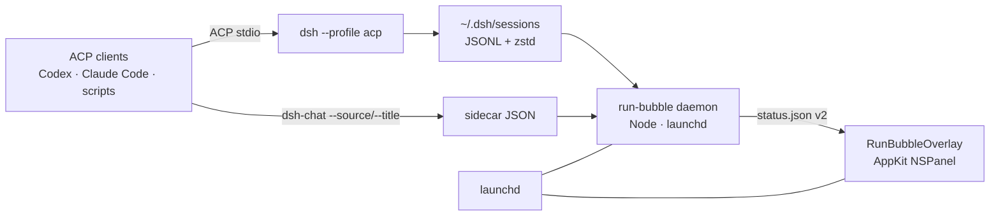

<p align="center">
  
</p>

<h1 align="center">dsh-run-bubble</h1>

<p align="center">
  <b>Always-on-top visibility for DeepSeek Harness sessions on macOS.</b><br>
  A native AppKit bubble backed by a small Node daemon. See roots, child agents,<br>
  tokens, models, and reasoning effort without switching windows.
</p>

<p align="center">
  <a href="https://github.com/Player-YN/dsh-run-bubble/actions/workflows/ci.yml"></a>
  
  
  
  
  
</p>

<p align="center">
  <a href="#quick-start">Quick start</a> ·
  <a href="#how-it-works">How it works</a> ·
  <a href="#metadata-contract">Metadata</a> ·
  <a href="#development">Development</a> ·
  <a href="README.zh-CN.md">简体中文</a>
</p>

<p align="center">
  
</p>

---

## Why

Coding agents increasingly run in the background: Codex, Claude Code, Cursor, or a
scripted ACP client starts a DeepSeek Harness session, that session fans out into
subagents, and the only place to watch it is another terminal tab.

`dsh-run-bubble` is a **local, always-mounted status bubble** for those external
sessions. It is intentionally small: one Node daemon, one AppKit panel, no
Electron, no WebView, no network calls, and no changes to the DSH kernel.

It is useful when you:

- run several ACP sessions in parallel and need to tell them apart at a glance;
- delegate work to child agents and want to see which ones are still running;
- watch token burn and reasoning effort while an agent works;
- keep DSH desktop closed and still want a status surface that stays alive.

> The bubble shows sessions started through `dsh --profile acp`, `headless`, or
> `sdk`. The desktop app's own chat sessions are intentionally filtered out so
> you never see two bubbles for the same conversation.

## Features

| | |
|---|---|
| **Always mounted** | The idle panel stays on screen as a compact pill; it never hides between runs. |
| **Multiple roots** | Every external session gets a stable color, a short id (`#a1b2`), source chip, title, and task preview. |
| **Child agents** | All active children are listed under their parent; click a root to collapse or expand its child list. |
| **Structured metadata** | Source, id, child count, model, effort, and turn are separate chips — no indistinguishable gray line. |
| **Pin** | Pin the expanded panel open; unpin to return to hover behavior. Pin state persists. |
| **Drag & scroll** | Long-press (~350 ms) to drag; the bottom-right anchor persists across restarts. Body scrolls above 420 px. |
| **Token totals** | Input / output / cache read / total, aggregated across roots and children. |
| **Native & quiet** | AppKit `NSPanel`, launchd, ~47 MB overlay. No Accessibility or Screen Recording permission. |
| **Local only** | No server, no telemetry, no account. Reads local logs and local sidecars. |

## Screenshots

<table>
  <tr>
    <td width="50%">
      
      <br><sub><b>Multiple roots, same title.</b> Stable colors + short ids + source chips.</sub>
    </td>
    <td width="50%">
      
      <br><sub><b>Per-root child lists.</b> Click a root row or its chevron to collapse it.</sub>
    </td>
  </tr>
  <tr>
    <td width="50%">
      
      <br><sub><b>Two sources at once.</b> Codex and Claude Code roots with task previews.</sub>
    </td>
    <td width="50%">
      
      <br><sub><b>Idle, still there.</b> A muted “空闲” pill instead of disappearing.</sub>
    </td>
  </tr>
</table>

<p align="center">
  
  <br><sub><b>Long lists scroll.</b> Header, pin, and token footer stay fixed.</sub>
</p>

## Quick start

### Requirements

- macOS 14 or newer
- Xcode Command Line Tools (`swiftc`) — `xcode-select --install`
- Node.js 20+
- `zstd` — `brew install zstd`
- A DeepSeek Harness installation that supports the `acp` profile (for sessions)

### Install

```sh
git clone https://github.com/Player-YN/dsh-run-bubble.git
cd dsh-run-bubble
./run-bubble install --rebuild
./run-bubble status
```

`install --rebuild` compiles `overlay.swift`, copies the daemon and binary to
`~/Library/Application Support/dsh-run-bubble/`, writes two user LaunchAgents,
and starts both. No `sudo` is required.

```sh
./run-bubble status       # PIDs + root/child/token counts
./run-bubble logs         # daemon + overlay stderr tails
./run-bubble snapshot /tmp/bubble.png
./run-bubble stop
./run-bubble start
./run-bubble uninstall
```

### Talk to DSH from another agent

The optional `interop/dsh-chat` wrapper writes a small sidecar so the bubble can
show an accurate source and title:

```sh
interop/install.sh
dsh-chat ask --source codex --title "Auth refactor" "Refactor the auth middleware."
```

`--source` accepts `codex`, `claude-code`, `cursor`, `terminal`, or a free-form
label. Without it, the daemon infers the source from the lock holder's process
tree and falls back to the first user prompt for the task preview.

## Usage

- **Hover** the collapsed pill to expand it.
- **Pin** the icon in the expanded header to keep it open when the pointer leaves.
- **Long-press and drag** anywhere on the panel to move it. The bottom-right
  anchor is written to `~/.dsh/run-bubble/position.json`.
- **Scroll** inside the body when the list is taller than 420 px.
- **Click a root row** (or its `▾`) to collapse/expand that root's children.
- **Idle** shows a muted pill; it does not hide.

## How it works



1. The daemon scans `~/.dsh/sessions` (or `$DSH_HOME/sessions`) for
   `session.v*.jsonl.zstd` logs.
2. It folds each log once into a compact state: title, model, reasoning effort,
   turn boundaries, token usage, child descriptors, and last event time. It never
   retains the event array.
3. A session is active when its last `turn/start` has no later `turn/end`. A
   killed process can leave a dangling turn, so the daemon also checks the
   `session.lock` holder with `lsof` and hides sessions with no live holder.
4. Sessions whose lock is held by the DSH desktop host are skipped, so the
   bubble is for terminal/agent-driven runs only.
5. The result is written atomically to `~/.dsh/run-bubble/status.json`; the
   AppKit panel polls it every 500 ms and redraws only when state changes.
6. The panel is always mounted. A short 2.5 s grace period prevents a child
   finishing or a single empty poll from flashing the bubble to idle.

No DSH kernel changes, no patching, no instrumentation.

## Metadata contract

### `status.json` (schema v2)

```json
{
  "schemaVersion": 2,
  "updatedAt": 1792316794509,
  "daemonPid": 29389,
  "roots": [
    {
      "id": "b7b0142f-...",
      "shortId": "b7b0142f",
      "colorKey": 0,
      "source": "codex",
      "sourceLabel": "Codex",
      "sourceConfidence": "explicit",
      "title": "Auth refactor",
      "titleSource": "explicit",
      "taskPreview": "Refactor the auth middleware into a provider chain",
      "model": "deepseek-flash",
      "reasoningEffort": "high",
      "turn": 2,
      "elapsedMs": 754000,
      "active": true,
      "tokens": { "input": 6400, "output": 541, "cacheRead": 19100, "total": 26200 },
      "children": []
    }
  ],
  "totals": { "sessions": 1, "children": 0, "tokens": {} }
}
```

### Sidecar (optional, explicit)

```json
{
  "source": "codex",
  "sourceLabel": "Codex",
  "title": "Auth refactor",
  "task": "Refactor the auth middleware into a provider chain",
  "updatedAt": "2026-10-18T09:32:21.116Z"
}
```

Path: `$DSH_HOME/run-bubble/sessions/<sessionId>.json` (default `~/.dsh`).
Explicit sidecar values beat daemon inference. `sourceConfidence` is
`explicit`, `inferred`, or `unknown`; inferred sources are prefixed with `~` in
the UI.

## Paths

| Path | Purpose |
|---|---|
| `~/Library/Application Support/dsh-run-bubble/` | Installed `daemon.mjs` + `RunBubbleOverlay` |
| `~/Library/LaunchAgents/com.dsh.runbubble.daemon.plist` | Daemon LaunchAgent |
| `~/Library/LaunchAgents/com.dsh.runbubble.overlay.plist` | Overlay LaunchAgent |
| `~/Library/Logs/dsh-run-bubble/` | stderr/stdout logs |
| `~/.dsh/run-bubble/status.json` | Latest snapshot |
| `~/.dsh/run-bubble/sessions/` | Optional sidecar metadata |
| `~/.dsh/run-bubble/position.json` | Drag anchor + pin state |

## Privacy & security

- Everything is local. There is no HTTP listener, analytics, crash reporting, or
  outbound network call.
- The daemon reads local session logs, optional local sidecars, and process
  command names (`ps -o ppid=,comm=`). It does **not** read environment
  variables or secrets.
- Sidecars are created with mode `0600`; the status file is `0600`.
- No Accessibility, Input Monitoring, or Screen Recording permission is needed.

See [SECURITY.md](SECURITY.md) for the vulnerability-reporting flow.

## Limitations

- **macOS only.** The daemon is portable Node, but the overlay is AppKit.
- **External sessions only.** Desktop-app chat sessions are filtered to avoid a
  duplicate bubble.
- **Source inference is a heuristic.** Use `dsh-chat --source` for an exact
  label; inferred sources show `~`.
- **Titles are not LLM-summarized.** The title is the explicit sidecar title or
  the first real user prompt.
- **Collapse state is per-process.** Pin and drag position persist; per-root
  collapse state resets on restart.
- **Memory scales with active log size.** The daemon decodes compressed logs on
  change; measured ~105 MB total idle and ~150–175 MB with 6–8 concurrent large
  sessions. The overlay itself stays around 47 MB.
- **UI copy is Chinese-first.** The structure is icon- and chip-led; English
  localization is welcome.

## Development

```sh
make check      # node --check + Swift typecheck
make build      # compile RunBubbleOverlay
make install    # install/restart LaunchAgents
make snapshot   # render the current status to /tmp/dsh-run-bubble.png
```

Demo modes never read the real session store:

```sh
./RunBubbleOverlay --demo --snapshot /tmp/expanded.png
./RunBubbleOverlay --demo-many --snapshot /tmp/many.png
./RunBubbleOverlay --demo-many --collapse-first --snapshot /tmp/collapse.png
./RunBubbleOverlay --demo-idle --snapshot /tmp/idle.png
./RunBubbleOverlay --collapsed --demo-idle --snapshot /tmp/pill.png
```

Project layout:

```text
.
├── daemon.mjs              # status engine (Node, no deps)
├── overlay.swift           # AppKit NSPanel + custom NSView
├── run-bubble              # build/install/start/stop/snapshot
├── interop/                # optional ACP wrapper + sidecar
├── docs/                   # banner, screenshots, images
├── Makefile
└── .github/workflows/ci.yml
```

CI runs on `macos-14`, checks both JavaScript files, and compiles the Swift
overlay.

## Contributing

Issues and PRs are welcome. Please read [CONTRIBUTING.md](CONTRIBUTING.md)
first; UI changes should include a before/after snapshot rendered with the
`--demo` flags.

If this saves you a tab switch, a star helps other agent-tooling people find it.

## License

[MIT](LICENSE) © 2026 Player-YN

## Acknowledgements

- [DeepSeek Harness](https://github.com/deepseek-ai) for the session store and
  ACP/headless profiles.
- [Agent Client Protocol](https://agentclientprotocol.com/) for the stdio
  interface used by `interop/dsh-chat`.
- Apple AppKit and launchd for making a 47 MB native overlay possible.
- [zstd](https://github.com/facebook/zstd) for the session log format.
