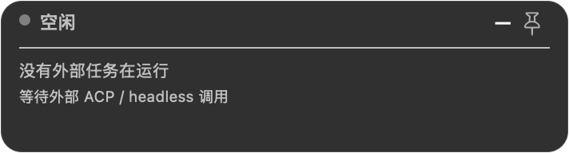
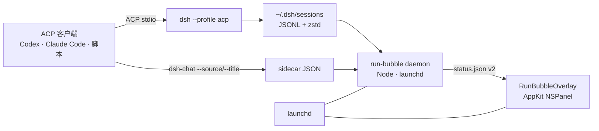

<p align="center">
  
</p>

<h1 align="center">dsh-run-bubble</h1>

<p align="center">
  <b>macOS 上常驻显示 DeepSeek Harness 外部会话状态的桌面气泡。</b><br>
  Node daemon + 原生 AppKit 面板，不打断当前窗口就能看到主 Session、子 Agent、<br>
  token、模型和推理强度。
</p>

<p align="center">
  <a href="https://github.com/Player-YN/dsh-run-bubble/actions/workflows/ci.yml"></a>
  
  
  
  
</p>

<p align="center">
  <a href="README.md">English</a> ·
  <a href="#快速开始">快速开始</a> ·
  <a href="#工作原理">工作原理</a> ·
  <a href="#元数据契约">元数据</a> ·
  <a href="#开发">开发</a>
</p>

<p align="center">
  
</p>

---

## 为什么做这个

现在越来越多的编码 Agent 在后台运行：Codex、Claude Code、Cursor，或者一个脚本化的 ACP
客户端会启动 DeepSeek Harness 会话，会话再并发派出子 Agent。想看状态，通常只能再开一个
终端标签页。

`dsh-run-bubble` 是一个**本地、常驻、置顶的状态气泡**：

- 一个 Node daemon，读取 `~/.dsh/sessions`；
- 一个 AppKit `NSPanel`，画在桌面角落；
- 不依赖 Electron / WebView，不联网，不改 DSH 内核；
- DSH 桌面端关掉也仍然工作。

适合这些场景：

- 同时跑多个 ACP Session，需要一眼分清谁是谁；
- 主子 Agent 并发，想知道还有哪些没结束；
- 盯 token 消耗、模型和 reasoning effort；
- 不想一直开着 DSH 桌面端，但仍想保留一个状态入口。

> 气泡只显示通过 `dsh --profile acp`、`headless` 或 `sdk` 启动的**外部会话**。
> 桌面端自己的聊天会话会被过滤，避免同一个对话出现两个气泡。

## 功能

| | |
|---|---|
| **常驻** | 空闲时缩成小胶囊，不隐藏；展开后可钉住。 |
| **多主 Session** | 每个 root 有稳定颜色、短 id（`#a1b2`）、来源 chip、标题和任务预览。 |
| **子 Agent** | 所有运行中的子 Agent 挂在对应 root 下；点击 root 可展开/收起。 |
| **结构化信息** | 来源、id、子数量、模型、推理强度、turn 分别用 chips 展示，不再是一整行同色灰字。 |
| **钉子** | 钉住展开态，鼠标移出也不收起；状态持久化。 |
| **拖动与滚动** | 长按 ~350ms 拖动，右下角锚点持久化；内容超过 420px 垂直滚动。 |
| **Token 统计** | 输入 / 输出 / 缓存读取 / 总量，按 root 和子 Agent 汇总。 |
| **原生轻量** | AppKit + launchd，overlay 约 47MB；不需要辅助功能或录屏权限。 |
| **纯本地** | 无服务端、无遥测、无账号，只读本地日志和 sidecar。 |

## 截图

<table>
  <tr>
    <td width="50%">
      
      <br><sub><b>多个同名 root。</b>稳定颜色 + 短 id + 来源 chip。</sub>
    </td>
    <td width="50%">
      
      <br><sub><b>按 root 收起子 Agent。</b>点击 root 行或箭头切换。</sub>
    </td>
  </tr>
  <tr>
    <td width="50%">
      
      <br><sub><b>两个来源同时运行。</b>Codex 和 Claude Code 各有任务预览。</sub>
    </td>
    <td width="50%">
      
      <br><sub><b>空闲也不消失。</b>低调的“空闲”胶囊。</sub>
    </td>
  </tr>
</table>

<p align="center">
  
  <br><sub><b>长列表滚动。</b>header、钉子和 token footer 固定不动。</sub>
</p>

## 快速开始

### 要求

- macOS 14+
- Xcode Command Line Tools（`swiftc`）：`xcode-select --install`
- Node.js 20+
- `zstd`：`brew install zstd`
- 可运行 `acp` profile 的 DeepSeek Harness（用于产生会话）

### 安装

```sh
git clone https://github.com/Player-YN/dsh-run-bubble.git
cd dsh-run-bubble
./run-bubble install --rebuild
./run-bubble status
```

`install --rebuild` 会编译 `overlay.swift`，把 daemon 和二进制复制到
`~/Library/Application Support/dsh-run-bubble/`，写入两个用户级 LaunchAgent 并启动。
不需要 `sudo`。

```sh
./run-bubble status       # PID + root/子 Agent/token 统计
./run-bubble logs         # daemon + overlay 日志
./run-bubble snapshot /tmp/bubble.png
./run-bubble stop
./run-bubble start
./run-bubble uninstall
```

### 从其他 Agent 调用 DSH

可选的 `interop/dsh-chat` 会写 sidecar，让气泡显示准确的来源和标题：

```sh
interop/install.sh
dsh-chat ask --source codex --title "Auth refactor" "Refactor the auth middleware."
```

`--source` 可填 `codex`、`claude-code`、`cursor`、`terminal` 或自定义标签。
不填时，daemon 会根据 lock holder 的进程树推断来源，并用首条用户消息作为任务预览。

## 使用方式

- **悬停**展开胶囊。
- **点击图钉**钉住展开态；再点取消。
- **长按拖动**移动面板，右下角锚点写入 `~/.dsh/run-bubble/position.json`。
- **滚动**查看超出 420px 的内容。
- **点击 root 行 / 箭头**收起或展开该 root 的子 Agent。
- 空闲时显示 muted 胶囊，不隐藏。

## 工作原理



1. daemon 扫描 `~/.dsh/sessions`（或 `$DSH_HOME/sessions`）下的
   `session.v*.jsonl.zstd`。
2. 一次折叠每条日志：标题、模型、推理强度、turn 边界、token、子 Agent 描述和最后事件
   时间；不保留事件数组。
3. 最后一个 `turn/start` 之后没有 `turn/end` 即视为运行中；进程被杀死可能留下悬空
   turn，所以还会用 `lsof` 检查 `session.lock` holder。
4. 如果 session 的锁由 DSH 桌面端持有，则跳过，避免和桌面端重复。
5. 结果原子写入 `~/.dsh/run-bubble/status.json`；AppKit 面板每 500ms 轮询一次，状态
   变化才重绘。
6. 面板始终挂载；子 Agent 结束或单次空轮询时保留 2.5 秒 last-non-empty，避免闪烁。

没有 DSH 内核改动，没有补丁，没有注入。

## 元数据契约

### `status.json`（schema v2）

```json
{
  "schemaVersion": 2,
  "updatedAt": 1792316794509,
  "daemonPid": 29389,
  "roots": [
    {
      "id": "b7b0142f-...",
      "shortId": "b7b0142f",
      "colorKey": 0,
      "source": "codex",
      "sourceLabel": "Codex",
      "sourceConfidence": "explicit",
      "title": "Auth refactor",
      "titleSource": "explicit",
      "taskPreview": "Refactor the auth middleware into a provider chain",
      "model": "deepseek-flash",
      "reasoningEffort": "high",
      "turn": 2,
      "elapsedMs": 754000,
      "active": true,
      "tokens": { "input": 6400, "output": 541, "cacheRead": 19100, "total": 26200 },
      "children": []
    }
  ],
  "totals": { "sessions": 1, "children": 0, "tokens": {} }
}
```

### Sidecar（可选，显式）

```json
{
  "source": "codex",
  "sourceLabel": "Codex",
  "title": "Auth refactor",
  "task": "Refactor the auth middleware into a provider chain",
  "updatedAt": "2026-10-18T09:32:21.116Z"
}
```

路径：`$DSH_HOME/run-bubble/sessions/<sessionId>.json`（默认 `~/.dsh`）。
显式 sidecar 优先于进程树推断。`sourceConfidence` 为 `explicit`、`inferred` 或
`unknown`；推断来源在 UI 里加 `~` 前缀。

## 路径

| 路径 | 用途 |
|---|---|
| `~/Library/Application Support/dsh-run-bubble/` | 安装后的 `daemon.mjs` + `RunBubbleOverlay` |
| `~/Library/LaunchAgents/com.dsh.runbubble.daemon.plist` | daemon LaunchAgent |
| `~/Library/LaunchAgents/com.dsh.runbubble.overlay.plist` | overlay LaunchAgent |
| `~/Library/Logs/dsh-run-bubble/` | stdout/stderr 日志 |
| `~/.dsh/run-bubble/status.json` | 最新状态快照 |
| `~/.dsh/run-bubble/sessions/` | 可选 sidecar |
| `~/.dsh/run-bubble/position.json` | 拖动锚点 + 钉子状态 |

## 隐私与安全

- 纯本地：没有 HTTP 监听、遥测、崩溃上报或外发请求。
- daemon 只读本地会话日志、可选 sidecar 和进程命令名（`ps -o ppid=,comm=`）；
  不读取环境变量或密钥。
- sidecar 和 status 文件权限为 `0600`。
- 不需要辅助功能、输入监控或录屏权限。

安全问题请走仓库 Security 页的 **Report a vulnerability**，不要公开贴真实 prompt 或日志。

## 限制

- **仅 macOS。** daemon 是可移植的 Node，但 overlay 是 AppKit。
- **仅外部会话。** 桌面端聊天会话会被过滤，避免重复。
- **来源推断是启发式。** 需要精确来源时用 `dsh-chat --source`；推断值显示 `~`。
- **标题不做 LLM 摘要。** 标题来自显式 sidecar 或首条真实用户消息。
- **折叠状态不持久化。** 钉子和拖动位置持久化，root 折叠状态重启后恢复展开。
- **内存随活跃日志大小增长。** 实测空闲约 105MB，6–8 个并发大日志时约
  150–175MB；overlay 本身约 47MB。
- **UI 文案以中文为主。** 结构和图标可读，欢迎补英文文案。

## 开发

```sh
make check      # node --check + Swift typecheck
make build      # 编译 RunBubbleOverlay
make install    # 安装/重启 LaunchAgents
make snapshot   # 渲染当前状态到 /tmp/dsh-run-bubble.png
```

Demo 模式不会读取真实 session store：

```sh
./RunBubbleOverlay --demo --snapshot /tmp/expanded.png
./RunBubbleOverlay --demo-many --snapshot /tmp/many.png
./RunBubbleOverlay --demo-many --collapse-first --snapshot /tmp/collapse.png
./RunBubbleOverlay --demo-idle --snapshot /tmp/idle.png
./RunBubbleOverlay --collapsed --demo-idle --snapshot /tmp/pill.png
```

目录结构：

```text
.
├── daemon.mjs              # 状态引擎（Node，无依赖）
├── overlay.swift           # AppKit NSPanel + 自绘 NSView
├── run-bubble              # build/install/start/stop/snapshot
├── interop/                # 可选 ACP wrapper + sidecar
├── docs/                   # banner、截图、图片
├── Makefile
└── .github/workflows/ci.yml
```

CI 在 `macos-14` 上检查两个 JS 文件并编译 Swift overlay。

## 贡献

欢迎 issue 和 PR。请先读 [CONTRIBUTING.md](CONTRIBUTING.md)；UI 改动请附带用
`--demo` 模式渲染的前后截图。

如果这个项目帮你少切了几次窗口，点个 star 能让更多做 Agent 工具的人看到它。

## License

[MIT](LICENSE) © 2026 Player-YN

## 致谢

- [DeepSeek Harness](https://github.com/deepseek-ai)：session store、ACP/headless
  profiles。
- [Agent Client Protocol](https://agentclientprotocol.com/)：`interop/dsh-chat`
  使用的 stdio 协议。
- Apple AppKit 和 launchd：让 47MB 原生 overlay 成为可能。
- [zstd](https://github.com/facebook/zstd)：会话日志压缩格式。
