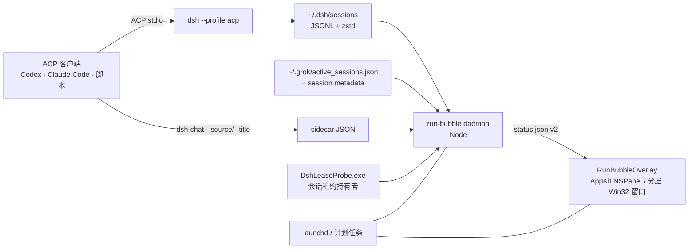

<p align="center">
  
</p>

<h1 align="center">dsh-run-bubble</h1>

<p align="center">
  <b>macOS 与 Windows 上常驻显示 DeepSeek Harness / Grok Build 会话状态的桌面气泡。</b><br>
  macOS 用原生 AppKit 面板，Windows 用分层 Win32 窗口，共用同一个轻量 Node daemon。<br>
  不打断当前窗口就能看到主 Session、子 Agent、Grok Build TUI、token、模型和推理强度。
</p>

<p align="center">
  <a href="https://github.com/Player-YN/dsh-run-bubble/actions/workflows/ci.yml"></a>
  
  
  
  
  
  
  
</p>

<p align="center">
  <a href="README.md">English</a> ·
  <a href="#快速开始">快速开始</a> ·
  <a href="#工作原理">工作原理</a> ·
  <a href="#元数据契约">元数据</a> ·
  <a href="#开发">开发</a>
</p>

<p align="center">
  
</p>

---

> **为外部 Agent 调用而设计。** 这个气泡服务的是"由**别的** agent 驱动 DSH"的场景——
> Codex、Claude Code、Cursor、脚本或 CI 用 `dsh --profile acp|headless|sdk` 起会话。
> 桌面端自己的聊天会话默认被过滤，避免同一个对话出现两个气泡；想一起看，点面板里的
> 显示器按钮（或 `config.json` 里 `"includeDesktop": true`）即可。

## 为什么做这个

现在越来越多的编码 Agent 在后台运行：Codex、Claude Code、Cursor，或者一个脚本化的 ACP
客户端会启动 DeepSeek Harness 会话，会话再并发派出子 Agent。想看状态，通常只能再开一个
终端标签页。

`dsh-run-bubble` 是一个**本地、常驻、置顶的状态气泡**：

- 一个 Node daemon，读取 `~/.dsh/sessions`；
- 一个 AppKit `NSPanel`，画在桌面角落；
- 不依赖 Electron / WebView，不联网，不改 DSH 内核；
- DSH 桌面端关掉也仍然工作。

适合这些场景：

- 同时跑多个 ACP Session，需要一眼分清谁是谁；
- 主子 Agent 并发，想知道还有哪些没结束；
- 盯 token 消耗、模型和 reasoning effort；
- 不想一直开着 DSH 桌面端，但仍想保留一个状态入口。

> 气泡默认只显示通过 `dsh --profile acp`、`headless` 或 `sdk` 启动的**外部会话**。
> 桌面端自己的聊天会话会被过滤，避免同一个对话出现两个气泡。

## 功能

| | |
|---|---|
| **极简空闲态** | 空闲时收缩成约 55 × 26 px、宽度随文案自适应的胶囊，不隐藏。 |
| **多主 Session** | 每个 root 有稳定颜色、短 id（`#a1b2`）、来源 chip、标题和任务预览。 |
| **子 Agent** | 所有运行中的子 Agent 挂在对应 root 下；点击 root 可展开/收起。 |
| **结构化信息** | 来源、id、子数量、模型、推理强度、turn 分别用 chips 展示，不再是一整行同色灰字。 |
| **钉子** | 钉住展开态，鼠标移出也不收起；状态持久化。 |
| **拖动与滚动** | 长按 ~350ms 拖动，右下角锚点持久化；内容超过 420px 垂直滚动。 |
| **Token 统计** | 输入 / 输出 / 缓存读取 / 总量，按 root 和子 Agent 汇总。 |
| **一键切换桌面会话** | 面板里的显示器按钮，图标切换桌面端会话是否显示，无文字无菜单。 |
| **全屏时自动让位** | 检测到游戏/视频等全屏应用占据所在显示器时自动隐藏，结束后自动回来。 |
| **原生轻量** | macOS 用 AppKit `NSPanel`，Windows 用分层 Win32 窗口；不需要辅助功能或录屏权限。 |
| **Grok Build provider** | 读取 `~/.grok/active_sessions.json`，把打开的 `grok` TUI 显示成 root，带标题、模型、effort、turn、token 和耗时。 |
| **纯本地** | 无服务端、无遥测、无账号，只读本地日志和 sidecar。 |

## 截图

<table>
  <tr>
    <td width="50%">
      
      <br><sub><b>多个同名 root。</b>稳定颜色 + 短 id + 来源 chip。</sub>
    </td>
    <td width="50%">
      
      <br><sub><b>按 root 收起子 Agent。</b>点击 root 行或箭头切换。</sub>
    </td>
  </tr>
  <tr>
    <td width="50%">
      
      <br><sub><b>两个来源同时运行。</b>Codex 和 Claude Code 各有任务预览。</sub>
    </td>
    <td width="50%">
      
      <br><sub><b>空闲也不消失。</b>内容自适应 55 × 26 小胶囊。</sub>
    </td>
  </tr>
</table>

<p align="center">
  
  <br><sub><b>长列表滚动。</b>header、钉子和 token footer 固定不动。</sub>
</p>

<p align="center">
  
  <br><sub><b>Grok Build。</b>打开的 `grok` TUI 自动出现在 DSH root 旁边，不需要 wrapper。</sub>
</p>

## 快速开始

### 要求

**macOS**

- macOS 14+
- Xcode Command Line Tools（`swiftc`）：`xcode-select --install`
- Node.js 20+
- `zstd`：`brew install zstd`
- 可运行 `acp` profile 的 DeepSeek Harness（用于产生会话）
- Grok Build（可选；打开的 `grok` TUI 会自动识别）

**Windows**

- Windows 10 1809+ 或 Windows 11
- [.NET 8 SDK](https://dotnet.microsoft.com/download)（编译 overlay 与租约探针）
- Node.js **22.15+**（需要内置 `zlib` 的 zstd 解压，推荐 24.x）
- 可运行 `acp` profile 的 DeepSeek Harness（用于产生会话）
- Grok Build（可选；打开的 `grok` TUI 会自动识别）

Windows 上**不需要** `zstd` 命令行：daemon 用 Node 内置解码器直接处理拼接的多帧 zstd。

### 安装（macOS）

```sh
git clone https://github.com/Player-YN/dsh-run-bubble.git
cd dsh-run-bubble
./run-bubble install --rebuild
./run-bubble status
```

`install --rebuild` 会编译 `overlay.swift`，把 daemon 和二进制复制到
`~/Library/Application Support/dsh-run-bubble/`，写入两个用户级 LaunchAgent 并启动。
不需要 `sudo`。

```sh
./run-bubble status       # PID + root/子 Agent/token 统计
./run-bubble logs         # daemon + overlay 日志
./run-bubble snapshot /tmp/bubble.png
./run-bubble stop
./run-bubble start
./run-bubble uninstall
```

### 安装（Windows）

```powershell
git clone https://github.com/Player-YN/dsh-run-bubble.git
cd dsh-run-bubble
pwsh -File .\run-bubble.ps1 install -Rebuild
pwsh -File .\run-bubble.ps1 status
```

`install` 会用 `dotnet publish` 构建两个程序——分层窗口 overlay
（`RunBubbleOverlay.exe`）和内核租约探针（`DshLeaseProbe.exe`）——复制到
`%LOCALAPPDATA%\dsh-run-bubble\`，注册两个用户级计划任务（`DshRunBubble-Daemon`、
`DshRunBubble-Overlay`，失败自动重启）并启动。**不需要管理员权限。**

```powershell
pwsh -File .\run-bubble.ps1 status      # PID、判定模式、探针状态、root/子 Agent/token
pwsh -File .\run-bubble.ps1 doctor      # 端到端自检
pwsh -File .\run-bubble.ps1 logs        # daemon + overlay 日志尾部
pwsh -File .\run-bubble.ps1 snapshot $env:TEMP\bubble.png
pwsh -File .\run-bubble.ps1 restart
pwsh -File .\run-bubble.ps1 uninstall   # 保留 ~\.dsh\run-bubble\* 不动
```

<p align="center">
  
  
  <br><sub><b>Windows。</b>分层 Win32 窗口 + 逐像素 alpha；空闲胶囊常驻不隐藏。
  更多状态（含浅色主题）见 <code>docs/images/windows/</code>。</sub>
</p>

### 显示哪些会话

气泡显示两个本地 provider：

- **DeepSeek Harness**：**外部驱动**的会话（`dsh --profile acp|headless|sdk`）。桌面端
  自己的聊天默认被过滤，避免同一个对话出现两个气泡。
- **Grok Build**：`~/.grok/active_sessions.json` 里登记的打开的 `grok` TUI 会话，不需要
  hook 或 wrapper；daemon 读取该会话的 `summary.json`、`signals.json`、`usage.json`。

Windows 上的归属是**精确**判定的：DSH 为每个会话持有一个命名内核信号量
（`Local\dsh-session-lock-<sha256>`），daemon 直接读出真实持有者 PID 再与桌面宿主比对，
而不是靠猜。

就想在气泡里看到桌面端的会话？点展开面板里的 **显示器按钮**——即时生效并写入
`config.json`，下次启动保持。（脚本/CI 仍可用 `RUN_BUBBLE_INCLUDE_DESKTOP=1`。）

### 面板行为

- 展开/折叠：悬停胶囊展开，移开折叠；钉子可保持常开。
- 空闲胶囊刻意做得极小（约 55 × 26 px），宽度随文案自适应。
- **全屏应用会自动把它藏起来。** 当前台窗口铺满气泡所在的那块显示器（游戏、全屏视频、
  演示文稿）时自动隐藏，窗口消失后自动恢复。想关掉这个行为，在 `config.json` 里设
  `"hideOnFullscreen": false`。

头部两个图标，从左到右：**显示器**（显示/隐藏桌面会话）、**钉子**。没有文字，没有菜单。

### 从其他 Agent 调用 DSH

可选的 `interop/dsh-chat` 会写 sidecar，让气泡显示准确的来源和标题。

```sh
# macOS
interop/install.sh
dsh-chat ask --source codex --title "Auth refactor" "Refactor the auth middleware."

# Windows
pwsh -File .\interop\install.ps1
dsh-chat ask --source codex --title "Auth refactor" "Refactor the auth middleware."
```

`--source` 可填 `codex`、`claude-code`、`cursor`、`terminal` 或自定义标签。
不填时，daemon 会根据会话租约持有者的父进程链推断来源，并用首条用户消息作为任务预览。

## 使用方式

- **悬停**展开胶囊。
- **点击图钉**钉住展开态；再点取消。
- **长按拖动**移动面板，右下角锚点写入 `~/.dsh/run-bubble/position.json`。
- **滚动**查看超出 420px 的内容。
- **点击 root 行 / 箭头**收起或展开该 root 的子 Agent。
- 空闲时显示 muted 胶囊，不隐藏。

## 工作原理



1. daemon 扫描 `~/.dsh/sessions`（或 `$DSH_HOME/sessions`）下的
   `session.v*.jsonl.zstd`，以及 `~/.grok/active_sessions.json`（或 `$GROK_HOME`）里
   打开的 Grok Build TUI 会话。
2. 一次折叠每条日志：标题、模型、推理强度、turn 边界、token、子 Agent 描述和最后事件
   时间；不保留事件数组。日志是**每追加一次就写一帧**的多帧 zstd，解帧器逐帧走，
   不能只解第一帧。
3. 活跃性来自**真实会话租约**而不是猜测：macOS 每次 refresh 用**一次批量
   `lsof`** 读所有 `session.lock` 持有者（不是每个 session 一个进程；另有 1s
   heartbeat，refresh 慢时 status 也不会变旧）；Windows 让 `DshLeaseProbe.exe`
   读 DSH 为每个会话创建的内核信号量
   （`Local\dsh-session-lock-<sha256>`）的持有者。没人持有 = 进程已死。探针不可用时
   降级为 `mtime`/sidecar 启发式，并在 `daemon.json` 标记 `"mode": "win-mtime"`。
4. 如果会话租约由 DSH 桌面端持有，则跳过，避免和桌面端重复。
5. Grok Build 条目会匹配到 `~/.grok/sessions/<encoded-cwd>/<id>/`，再用 `summary.json`、
   `signals.json`、`usage.json` 取标题、模型、effort、turn 和 token；PID 已死的 registry
   条目会被忽略。
6. 结果原子写入 `~/.dsh/run-bubble/status.json`；overlay 每 500ms 轮询一次，状态
   变化才重绘。
7. 面板始终挂载；子 Agent 结束或单次空轮询时保留 2.5 秒 last-non-empty，避免闪烁。

没有 DSH 内核改动，没有补丁，没有注入。租约探针严格只读：从不获取、等待或释放任何
会话租约。

## 元数据契约

### `status.json`（schema v2）

```json
{
  "schemaVersion": 2,
  "updatedAt": 1792316794509,
  "daemonPid": 29389,
  "roots": [
    {
      "id": "b7b0142f-...",
      "shortId": "b7b0142f",
      "colorKey": 0,
      "source": "codex",
      "sourceLabel": "Codex",
      "sourceConfidence": "explicit",
      "title": "Auth refactor",
      "titleSource": "explicit",
      "taskPreview": "Refactor the auth middleware into a provider chain",
      "model": "deepseek-flash",
      "reasoningEffort": "high",
      "turn": 2,
      "elapsedMs": 754000,
      "active": true,
      "tokens": { "input": 6400, "output": 541, "cacheRead": 19100, "total": 26200 },
      "children": []
    }
  ],
  "totals": { "sessions": 1, "children": 0, "tokens": {} }
}
```

### `config.json`（overlay ↔ daemon）

由面板的显示器按钮写入，两个进程都读取。

```json
{ "includeDesktop": false, "hideOnFullscreen": true }
```

路径：`$DSH_HOME/run-bubble/config.json`（默认 `~/.dsh/run-bubble/config.json`）。
`includeDesktop` 的优先级：`RUN_BUBBLE_INCLUDE_DESKTOP` 环境变量 → `config.json` → `false`。
未知字段会被保留。

### Sidecar（可选，显式）

```json
{
  "source": "codex",
  "sourceLabel": "Codex",
  "title": "Auth refactor",
  "task": "Refactor the auth middleware into a provider chain",
  "updatedAt": "2026-10-18T09:32:21.116Z"
}
```

路径：`$DSH_HOME/run-bubble/sessions/<sessionId>.json`（默认 `~/.dsh`）。
显式 sidecar 优先于进程树推断。`sourceConfidence` 为 `explicit`、`inferred` 或
`unknown`；推断来源在 UI 里加 `~` 前缀。

## 路径

**macOS**

| 路径 | 用途 |
|---|---|
| `~/Library/Application Support/dsh-run-bubble/` | 安装后的 `daemon.mjs` + `RunBubbleOverlay` |
| `~/Library/LaunchAgents/com.dsh.runbubble.daemon.plist` | daemon LaunchAgent |
| `~/Library/LaunchAgents/com.dsh.runbubble.overlay.plist` | overlay LaunchAgent |
| `~/Library/Logs/dsh-run-bubble/` | stdout/stderr 日志 |
| `~/.dsh/run-bubble/status.json` | 最新状态快照 |
| `~/.dsh/run-bubble/sessions/` | 可选 sidecar |
| `~/.dsh/run-bubble/position.json` | 拖动锚点 + 钉子状态 |
| `~/.grok/active_sessions.json` | 打开的 Grok Build TUI（只读） |
| `~/.grok/sessions/**/summary.json` | Grok Build 标题、模型、effort、cwd |
| `~/.grok/sessions/**/signals.json` / `usage.json` | Grok Build turn/token 统计 |

**Windows**

| 路径 | 用途 |
|---|---|
| `%LOCALAPPDATA%\dsh-run-bubble\` | 安装后的 `daemon.mjs`、`src\win\*`、`RunBubbleOverlay.exe`、`DshLeaseProbe.exe` |
| `%LOCALAPPDATA%\dsh-run-bubble\logs\` | daemon/overlay 的 stdout + stderr 日志 |
| 计划任务 `DshRunBubble-Daemon`、`DshRunBubble-Overlay` | 用户登录触发、失败自动重启 |
| `%USERPROFILE%\.dsh\run-bubble\status.json` | 最新状态快照 |
| `%USERPROFILE%\.dsh\run-bubble\sessions\` | 可选 sidecar |
| `%USERPROFILE%\.dsh\run-bubble\position.json` | 拖动锚点 + 钉子状态 |
| `%USERPROFILE%\.dsh\run-bubble\daemon.json` | daemon pid + 判定模式（`win-lease` / `win-mtime`） |
| `%USERPROFILE%\.dsh\run-bubble\config.json` | 面板开关：`includeDesktop`、`hideOnFullscreen` |

## 隐私与安全

- 纯本地：没有 HTTP 监听、遥测、崩溃上报或外发请求。
- daemon 只读本地会话日志、可选 sidecar 和进程元数据；**不读取环境变量或密钥**。
- macOS 上用 `ps -o ppid=,comm=` 读进程命令行。
- Windows 上读进程表（`Get-CimInstance Win32_Process`），并通过 `DshLeaseProbe.exe`
  读内核句柄表——**仅**用于确定哪个 PID 持有会话租约。探针只做只读的句柄复制，向
  NtQueryObject 询问对象**名字**，不读文件内容、不读内存、不碰凭据。
- sidecar 权限在 POSIX 下为 `0600`，Windows 下依赖用户目录 ACL；status 文件同样只对
  本人可读。
- macOS 不需要辅助功能/输入监控/录屏权限；Windows 不需要管理员权限。

安全问题请走仓库 Security 页的 **Report a vulnerability**，不要公开贴真实 prompt 或日志。

## 限制

- **两套 overlay，一个引擎。** macOS 用 Swift/AppKit（`overlay.swift`）；Windows 用
  C#/.NET 8 + 分层 Win32 窗口（`src/overlay/`）。daemon 与 `status.json` 契约共用。
- **仅外部会话。** 桌面端聊天会话默认被过滤，避免重复；面板的显示器按钮或
  `config.json` 里的 `"includeDesktop": true` 可随时把它们放回来。
- **全屏识别基于窗口矩形。** macOS 用 `CGWindowList` 找铺满气泡所在显示器的前台窗口；
  Windows 对无边框/普通全屏识别可靠。使用*独占* DirectX 全屏的游戏会把桌面切走，
  此时气泡本来就不可见（无需处理）。
- **Windows 活跃性依赖探针。** 租约探测需要 `DshLeaseProbe.exe`；缺失时降级为
  `mtime`/sidecar 启发式（`mode: "win-mtime"`），对长时间静默的会话可能短暂误判。
  不经 `interop/dsh-chat` 启动的外部 `dsh --profile acp` 没有 sidecar，来源在探针
  解析出持有者之前会显示为 `Unknown`。
- **Windows 无虚拟桌面固定。** macOS 可钉在所有 Space（`canJoinAllSpaces`）；Windows
  只保证置顶，面板位于当前虚拟桌面。
- **来源推断是启发式。** 需要精确来源时用 `dsh-chat --source`；推断值显示 `~`。
- **标题不做 LLM 摘要。** 标题来自显式 sidecar、DSH 的 title 事件或首条真实用户消息。
- **折叠状态不持久化。** 钉子和拖动位置持久化，root 折叠状态重启后恢复展开。
- **内存随活跃日志大小增长。** 实测空闲约 105MB，6–8 个并发大日志时约
  150–175MB；overlay 本身 macOS 约 47MB、Windows 约 60–90MB。
- **Grok Build 目前只覆盖打开的 TUI 会话。** headless `grok agent` 不会登记 active TUI
  session，所以暂时不显示。
- **UI 文案以中文为主。** 结构和图标可读，欢迎补英文文案。

## 开发

**macOS**

```sh
make check      # node --check + Swift typecheck
make build      # 编译 RunBubbleOverlay
make install    # 安装/重启 LaunchAgents
make snapshot   # 渲染当前状态到 /tmp/dsh-run-bubble.png
```

**Windows**

```powershell
pwsh -File .\build.ps1            # dotnet publish overlay + 租约探针到 dist\
pwsh -File .\build.ps1 -Clean     # 先清 dist\
pwsh -File .\run-bubble.ps1 install -Rebuild
node tests\smoke.mjs              # 用合成会话库验证 daemon 契约
```

Demo 模式不会读取真实 session store：

```sh
# macOS
./RunBubbleOverlay --demo --snapshot /tmp/expanded.png
./RunBubbleOverlay --demo-many --snapshot /tmp/many.png
./RunBubbleOverlay --demo-many --collapse-first --snapshot /tmp/collapse.png
./RunBubbleOverlay --demo-idle --snapshot /tmp/idle.png
./RunBubbleOverlay --collapsed --demo-idle --snapshot /tmp/pill.png

# Windows
.\dist\RunBubbleOverlay.exe --demo --snapshot $env:TEMP\expanded.png
.\dist\RunBubbleOverlay.exe --demo-many --snapshot $env:TEMP\many.png
.\dist\RunBubbleOverlay.exe --demo-many --collapse-first --snapshot $env:TEMP\collapse.png
.\dist\RunBubbleOverlay.exe --demo-idle --snapshot $env:TEMP\idle.png
.\dist\RunBubbleOverlay.exe --demo-idle --collapsed --snapshot $env:TEMP\pill.png
```

目录结构：

```text
.
├── daemon.mjs                  # 状态引擎（Node，无依赖，双平台）
├── src/win/                    # Windows 专用模块：进程表、多帧 zstd、租约判定
├── overlay.swift               # macOS：AppKit NSPanel + 自绘 NSView
├── src/overlay/                # Windows：分层 Win32 窗口（C#/.NET 8）
├── src/lease-probe/            # Windows：只读内核租约探针（C#）
├── run-bubble                  # macOS：build/install/start/stop/snapshot
├── run-bubble.ps1              # Windows：同样的子命令
├── build.ps1                   # Windows：dotnet publish 流程
├── tests/                      # daemon 冒烟测试 + 合成会话库
├── interop/                    # 可选 ACP wrapper + sidecar
├── docs/                       # banner、截图、设计笔记
├── Makefile
└── .github/workflows/ci.yml
```

CI 同时跑 `macos-14`（Swift overlay + 共用 JS）和 `windows-latest`（overlay、租约探针、
daemon 冒烟测试、全部 demo 截图）。Windows 移植的设计笔记见
[docs/PORT-WINDOWS.md](docs/PORT-WINDOWS.md) 与
[docs/dsh-internals-windows.md](docs/dsh-internals-windows.md)。

## 贡献

欢迎 issue 和 PR。请先读 [CONTRIBUTING.md](CONTRIBUTING.md)；UI 改动请附带用
`--demo` 模式渲染的前后截图。

如果这个项目帮你少切了几次窗口，点个 star 能让更多做 Agent 工具的人看到它。

## License

[MIT](LICENSE) © 2026 Player-YN

## 致谢

- [DeepSeek Harness](https://github.com/deepseek-ai)：session store、ACP/headless
  profiles。
- [Agent Client Protocol](https://agentclientprotocol.com/)：`interop/dsh-chat`
  使用的 stdio 协议。
- Apple AppKit 和 launchd：让 47MB 原生 overlay 成为可能。
- .NET 8 / WinForms 与 Win32 分层窗口 API：Windows overlay 与只读内核租约探针。
- [zstd](https://github.com/facebook/zstd)：会话日志压缩格式。
